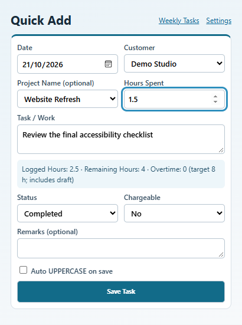
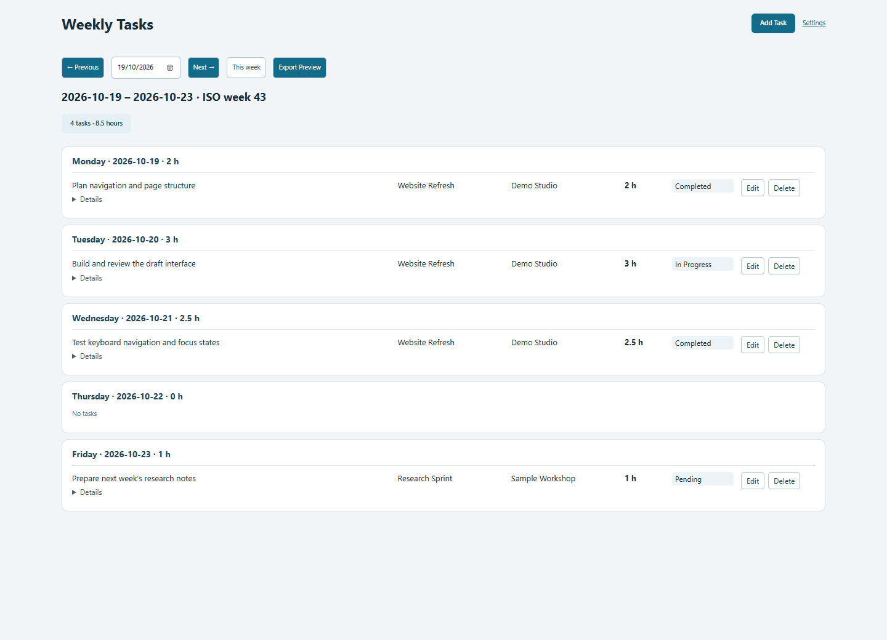
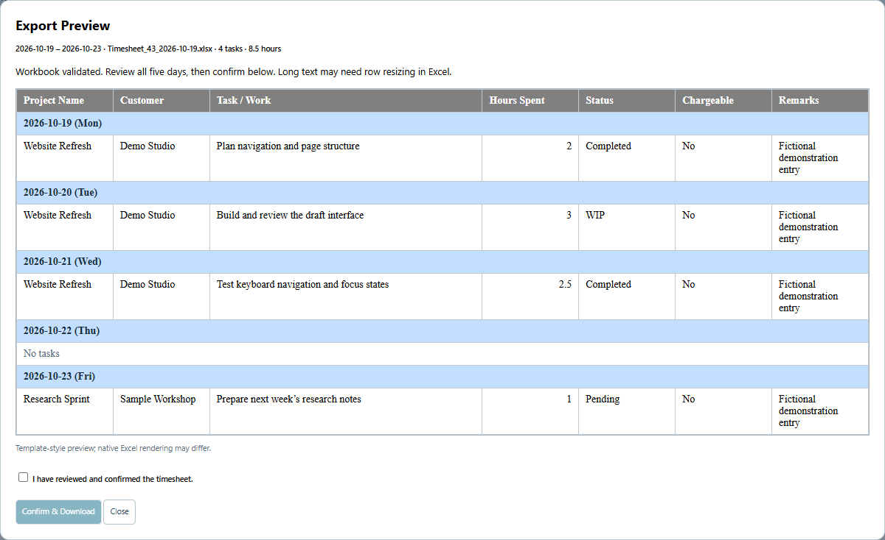
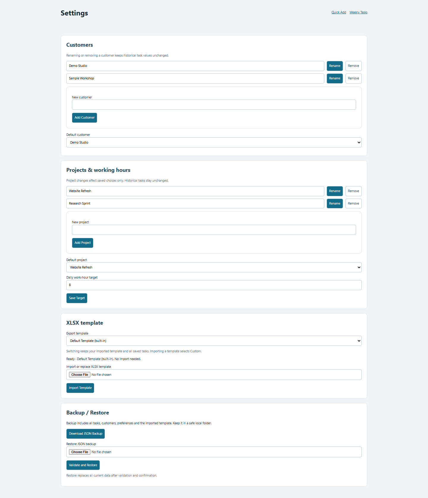

# Quick Timesheet · Local Edition V0.3

Private, offline work logging for Chrome and Edge. **Export a formatted weekly XLSX immediately—no template import or account needed.**

## Features

- Quick Add with customers, projects, uppercase preference and live daily-hours totals.
- Weekly dashboard, historical weeks, editing and confirmed deletion.
- Built-in Default and imported Custom templates with automatic overflow rows.
- Spreadsheet preview, workbook validation and explicit download confirmation.
- Complete local JSON backup/restore; no cloud services.

## Screenshots

Real Edge extension screens with fictional demonstration data only.

### Quick Add

### Weekly Tasks

### Export Preview

### Settings

## Install in Chrome or Edge

1. Extract the release ZIP into a permanent folder, or use the source folder.
2. Open `chrome://extensions` or `edge://extensions`.
3. Enable **Developer mode**, choose **Load unpacked**, and select the folder containing `manifest.json`.
4. Pin **Quick Timesheet** to the toolbar. No build step is required.

For an existing installation, keep its folder location, replace the source files and click **Reload** on the extensions page. Back up first; do not remove the extension to update it.

## Quick start

1. Open Quick Add and choose a customer (one-time entries need no setup).
2. Enter the date, optional project, work description and hours, then **Save Task**.
3. Open **Weekly Tasks**, select a week and choose **Export Preview**.
4. Review all five days, check **I have reviewed and confirmed the timesheet**, then **Confirm & Download**.

## Default vs Custom XLSX templates

Choose **Settings → Export template**:

| Mode | Behavior |
| --- | --- |
| **Default Template (built-in)** | Ready on fresh installations. Generated entirely offline with generic grey headers, blue weekday rows, wrapped text, estimated row heights and landscape printing fitted to one page wide. |
| **Custom Template (user-imported)** | Uses your compatible imported workbook, preserving company formatting and page settings. Importing selects Custom. Existing installations with imported templates retain Custom. |

Switching modes keeps imported bytes and saved tasks. Missing or invalid Custom templates show a warning; select Default or import a replacement. The private development reference workbook is never distributed.

Both modes export only **Sheet1**, with **Project Name · Customer · Task / Work · Hours Spent · Status · Chargeable · Remarks**. Dates appear on five weekday separator rows, without a dedicated Date column.

## Weekly export and confirmation

Preview shows Monday–Friday, including empty days, filename, task count and hours. Each download starts with fresh template bytes, expands weekday sections and reopens the generated XLSX to validate dates, placement, values and formatting. **In Progress** exports as **WIP**. New tasks default to **Chargeable: No**.

Successful validation and an explicit review checkbox are required. Data or template changes reset confirmation; reopen preview to validate again. Repeated clicks cannot download the same validated snapshot twice. Exporting never deletes tasks.

Filename example: `Timesheet_43_2026-10-19.xlsx`. ISO week and Monday come from the selected week, including across year boundaries.

## Customer and Project settings

Add, rename, remove and choose default customers/projects. One-time choices do not change saved lists. Renaming or removing choices never rewrites historical tasks. Older records without projects remain valid with blank projects.

The daily target defaults to **8 hours**. Quick Add shows logged, remaining and overtime hours for the selected date, including the draft in remaining/overtime. Editing excludes the original task before calculating. Overtime is informational and does not prevent saving.

## Backup / Restore

**Download JSON Backup** includes tasks, customers, projects, preferences, template selection and imported Custom bytes—even while Default is selected. Keep backups in a safe local folder.

To restore, select the JSON file, choose **Validate and Restore**, and confirm replacement. Back up current data first. Legacy backups remain supported: an included custom template selects Custom; otherwise Default is available immediately. Invalid backups leave current data intact.

## Offline privacy and known limitations

Data stays in this browser profile: tasks/preferences in `chrome.storage.local`, imported templates in IndexedDB. No backend, authentication, analytics, cloud integration, runtime CDN or external transmission. Only the `storage` permission is requested. Removing the extension or changing profiles requires a backup to retain data.

- Reports cover Monday–Friday. Weekend tasks remain editable, but export warns and rejects the week rather than silently omitting them.
- Native Excel/Calc rendering and printing remain unverified. Preview is an approximation. Default row heights are estimated up to Excel's height limit; very long text can still need resizing. Custom row heights stay unchanged.
- Custom templates must match the supported weekday layout. Non-date formulas, merged task cells, 1904 dates and incompatible layouts are rejected; arbitrary formula recalculation is unsupported.
- Limits: 20 MB imported template, 60 MB expanded XML, 100 MB backup; browser quotas also apply. Failures are reported. Unreferenced older template versions can remain locally.

## Development and QA

See [QA.md](QA.md) for actual checks and unverified environments. Node and Python are not required to use the extension.

- `node tests/run.mjs`: custom-template/application regressions (requires the private local test reference).
- `node tests/v03.mjs`: Default export, migration, switching and real screenshot capture; fictional data and a generated generic custom fixture only.
- `python tests/check_workbook.py` and `python tests/check_default.py`: independent ZIP/XML checks.
- `node scripts/package.mjs`: builds `dist/quick-timesheet-0.3.0.zip` from an explicit public-file allowlist excluding references and tests.

Browser QA uses Node, installed Edge and Playwright Core. Set `CODEX_NODE_MODULES` to its modules directory and optionally `CHROMIUM_PATH`. Tests use isolated temporary profiles. Runtime ZIP processing uses bundled fflate 0.8.3 ([MIT license](vendor/LICENSE)).